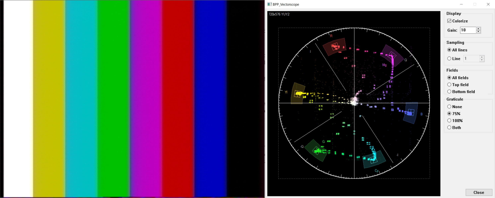

# BPP_Vectorscope: вектороскоп для BeholdTV

Плагин обработки (`BPP_*.dll`) для BeholdTV 5.28, который строит Cb/Cr каждой пары пикселей YUY2. Окно, настройки и сборка устроены как в [../BPP_Waveform](../BPP_Waveform/README.md). API и сборка в gcc: [../../PLUGIN_SDK.md](../../PLUGIN_SDK.md).

Обновлено 2026-10-28.

---

## Сборка, установка, работа

| Файл | Что это |
|---|---|
| `BPP_Vectorscope.cpp` | Плагин и самотест (`-DVECTORSCOPE_TEST`) |
| `BPP_Vectorscope.rc`, `resource.h` | Окно |ы
| `build.sh` | Запускает самотест, затем собирает `BPP_Vectorscope.dll`. Другой gcc задаётся через `GCC_BIN` |

1. `sh build.sh`. Команда `./vectorscope_test.exe out.bmp` дополнительно рисует синтетические полосы 75 % на экране вектороскопа, чтобы проверить сетку без BeholdTV.
2. Закройте BeholdTV, скопируйте `BPP_Vectorscope.dll` в `C:\Program Files (x86)\BeholdTV\Plugins\` (нужны права администратора).
3. Запустите BeholdTV, добавьте «Vectorscope» в цепочку **Preview**, перезапустите BeholdTV.
4. Нажмите кнопку настроек плагина: окно откроется рядом с видео. Размер меняется перетаскиванием краёв (не меньше исходного): растёт экран, панель настроек остаётся справа. Кнопка сворачивания убирает окно на его собственную кнопку в панели задач. **Always on top** находится в системном меню (правый щелчок по заголовку): с ним окно остаётся поверх всех программ, а не только BeholdTV. Закрывается кнопкой Close, клавишей Esc или крестиком. Положение, размер и настройки сохраняются в `%APPDATA%\BeholdTV\Plugins\BPP_Vectorscope.ini` (`[DIALOG] DlgWndPosX/Y`, `DlgWndWidth/Height`, `Topmost`, `[GLOBAL] AllLines`, `Line`, `Field`, `Colorize`, `Gain`, `Graticule`).

Внешний вид повторяет вектороскоп decode-orc. Что показывается:
- Одна точка на пару пикселей YUY2: Cb по горизонтали (вправо = +B−Y), Cr по вертикали (вверх = +R−Y), центр = 128/128 (нет цвета). Яркость точки растёт как квадратный корень из числа попаданий, поэтому видны и одиночные точки, и плотные области.
- **Colorize**: каждая точка своим цветовым тоном (у центра белая); без галочки след зелёный.
- **Gain** 1–100 (по умолчанию 10): яркость следа.
- Окружность на Cb/Cr ±112 (16/240, ±350 мВ), риски через 2° (длинные через 10°), оси Cb/Cr.
- Линии I / Q / −I / −Q под углами 123° / 33° / 303° / 213°. Линия I совпадает с линией телесных тонов.
- Серый пунктирный квадрат: диапазон цветоразностных сигналов 16..240 (его углы лежат за окружностью).
- **Graticule None / 75% / 100% / Both**: для каждой полосы сектор ±10° / ±10 % в цвете полосы, малый квадрат ±3° / ±5 % и перекрестие на точной цели BT.601 (красный 75 % = Cb 100, Cr 212). 75 % = полосы 100/0/75/0 по BT.471, т. е. полосы EBU в PAL. След накладывается на секторы через OR и внутри них остаётся виден.
- **All lines / Line N**: весь кадр или одна строка кадра, как в осциллографе.
- **Fields: All / Top / Bottom**: при All lines меряется только одно поле чересстрочного кадра. Top = строки кадра 1, 3, 5…, Bottom = 2, 4, 6…. Названия по положению в кадре, а не по порядку во времени: какое поле идёт первым, зависит от захвата. Предполагается, что BeholdTV передаёт кадры без деинтерлейсинга (это видно по «гребёнке» на быстром движении). При Line N группа неактивна: одна строка и так принадлежит одному полю. В поле вдвое меньше отсчётов, поэтому след немного тусклее; при необходимости увеличьте Gain.
- При входе RGB24 выводится сообщение, следа нет.

---

## Источники

| Файл | Что он даёт вектороскопу |
|---|---|
| [../BPP_Waveform/ref/st0125-2013.pdf](../BPP_Waveform/ref/st0125-2013.pdf) | SMPTE ST 125:2013. 8-битные Cb/Cr: 128 = ноль, 16/240 = ±350 мВ (см. README осциллографа, §2) |
| [ref/R-REC-BT.471-1-198607.pdf](ref/R-REC-BT.471-1-198607.pdf) | ITU-R BT.471-1, обозначения цветных полос. 100/0/75/0 = тип (b), полосы EBU в PAL |
| [ref/ebu-n010-1998.pdf](ref/ebu-n010-1998.pdf) | EBU Tech N10-1998, уровни аналогового компонентного сигнала: Y 0–700 мВ, E'CB/E'CR ±350 мВ, Y' = 0,299 R' + 0,587 G' + 0,114 B' |
| [ref/rp0219-1-2014.pdf](ref/rp0219-1-2014.pdf) | SMPTE RP 219-1:2014, полосы HD/SD с таблицами 10-битных кодов. Это значения BT.709 (HD), а не цели для SD; только для справки |

Ссылки: https://www.itu.int/rec/R-REC-BT.471-1-198607-I/en, https://tech.ebu.ch (N10), https://pub.smpte.org/doc/rp219-1/. Свободной копии SMPTE EG 1-1990 (композитные полосы NTSC, −I/+Q) найти не удалось.

Поэтому цели сетки для SD вычисляются по кодированию BT.601 цветов полос (`BarTarget`): Cb = 128 + 224 (−0,168736 R′ − 0,331264 G′ + 0,5 B′), Cr = 128 + 224 (0,5 R′ − 0,418688 G′ − 0,081312 B′), где R′G′B′ = 0,75 или 1,0. Расчёт идёт в плавающей точке, а не через целочисленную `RgbToYuv` из BPP_Waveform, которая округляет Cr жёлтого 75 % до 141 вместо 142.
