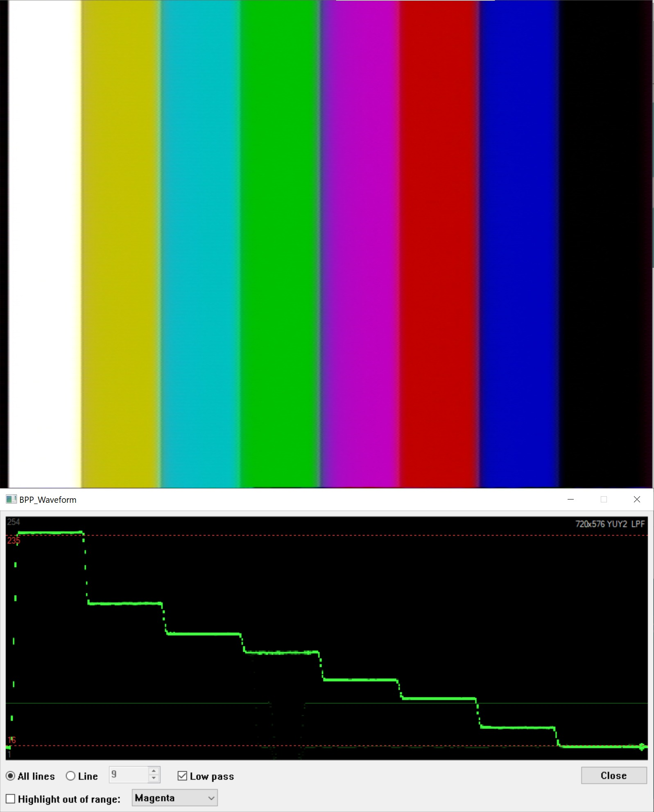

# BPP_Waveform: осциллограф видеосигнала для BeholdTV

Плагин обработки (`BPP_*.dll`) для BeholdTV 5.28, который строит осциллограмму яркости кадра. API и сборка в gcc: [../../PLUGIN_SDK.md](../../PLUGIN_SDK.md).

Обновлено 2026-10-28.

---

## 0. Сборка, установка, работа

| Файл | Что это |
|---|---|
| `BPP_Waveform.cpp` | Плагин и самотест подсчёта отсчётов (`-DWAVEFORM_TEST`) |
| `BPP_Waveform.rc`, `resource.h` | Окно |
| `build.sh` | Запускает самотест, затем собирает `BPP_Waveform.dll`. Другой gcc задаётся через `GCC_BIN` |

1. `sh build.sh`
2. Закройте BeholdTV, скопируйте `BPP_Waveform.dll` в `C:\Program Files (x86)\BeholdTV\Plugins\` (нужны права администратора).
3. Запустите BeholdTV, добавьте «Waveform monitor» в цепочку **Preview**, перезапустите BeholdTV.
4. Нажмите кнопку настроек плагина: окно осциллографа откроется и останется рядом с видео. Размер меняется перетаскиванием краёв (не меньше исходного): растёт экран, элементы управления остаются внизу и справа. Кнопка сворачивания убирает окно на его собственную кнопку в панели задач. **Always on top** находится в системном меню (правый щелчок по заголовку): с ним окно остаётся поверх всех программ, а не только BeholdTV. Закрывается кнопкой Close, клавишей Esc или крестиком. Положение, размер и «поверх всех» сохраняются в `%APPDATA%\BeholdTV\Plugins\BPP_Waveform.ini` (`[DIALOG] DlgWndPosX/Y`, те же ключи, что у FreqFilter, плюс `DlgWndWidth/Height`, `Topmost`).

Что показывается:
- Только яркость (Y), один столбец на пару пикселей (360 столбцов при ширине 720); чем ярче зелёный, тем больше отсчётов на этом уровне.
- Вертикальная шкала в 8-битных кодах, 1–254 (серые линии). Коды 0 и 255 рисуются на линиях 1 и 254.
- Границы ограниченного диапазона 16 и 235: красные пунктирные линии.
- Справа вверху: размер кадра и формат от BeholdTV (`720x576 YUY2`), что заодно отвечает на открытый вопрос из §1, а также `line N` и `LPF`, когда они включены. При входе RGB24 выводится сообщение, следа нет.
- **All lines / Line N**: весь кадр или одна строка кадра (1 = верхняя строка кадра, который передаёт BeholdTV, а не номер строки в эфирном стандарте; значения больше высоты кадра дают последнюю строку). Одна строка рисуется с полной яркостью.
- **Low pass**: горизонтальный гауссов фильтр по Y перед построением, −3 дБ на 1 МГц (частота BT.601, пересчитанная на ширину кадра)
- **Highlight out of range on video**: пиксели с Y ниже 16 или выше 235 закрашиваются на изображении выбранным цветом (Magenta по умолчанию, далее Pink, Red, Yellow, Cyan, Blue). Проверяется исходный Y (без фильтра); уровни цветности не проверяются. Пара пикселей YUY2 делит общие цветовые отсчёты, поэтому соседний пиксель в пределах диапазона получает оттенок цвета подсветки. Осциллограмма снимается до закраски и показывает настоящие уровни. Закраска работает и при закрытом окне.
- **Держите плагин только в цепочке Preview.** В цепочке Capture закраска попадёт в запись.
- Все настройки сохраняются в `.ini` (`[GLOBAL] AllLines`, `Line`, `LowPass`, `Paint`, `PaintColor`). Ключ `ScaleMv` от старых сборок игнорируется.

---

## 1. Формат отсчётов, который BeholdTV передаёт плагину

**8 бит на компоненту. 10-битного пути нет.**

| Источник | Что в нём сказано |
|---|---|
| SDK `Common.h`, `ePixFmt` | Есть только два формата: `fYUY2` (0) и `fRGB24` |
| SDK `PARAM_STR.BitPerPixel` | «2 if 16 bpp, 3 if 24 bpp», т. е. YUY2 = 8-битный Y + 8-битные Cb/Cr (4:2:2), RGB24 = 8-битные B, G, R |
| `DSPLUGINVER` 0x0003 | Не менялся с 2009 года; плагины 5.28 используют те же экспорты |

Раскладка по FourCC YUY2: байты `Y0 Cb Y1 Cr` на пару пикселей, первой идёт верхняя строка. Шаг строки `SrcPitch` (= ширина × 2).

**Пока не подтверждено, какой из двух форматов на самом деле отдаёт 5.28.** Плагин получает его в `PARAM_STR.PixFmt` при запуске (Start), поэтому должен обрабатывать оба и при первом запуске записать его в журнал. На этот вопрос отвечает и сборка `BPP_Inverse_diag.dll` (пишет журнал в `%TEMP%\BPP_Inverse.log`), но она не включена: в `Plugins.ini` [Preview] стоит `BPP_Inverse.dll`, обычная сборка.

Также не подтверждено, студийный ли диапазон уровней (Y 16–235) или полный (0–255). Декодер SAA713x должен выдавать студийный диапазон BT.601, а регулировки изображения (Brightness 128, Contrast 64, Saturation 64) его меняют. В RGB24 диапазон зависит от того, кто преобразует. Осциллограмма чёрного и белого испытательных сигналов покажет это сразу.

## 2. Опорные уровни (SMPTE ST 125:2013)

[ref/st0125-2013.pdf](ref/st0125-2013.pdf): *SDTV Component Video Signal Coding 4:4:4 and 4:2:2 for 13.5 MHz and 18 MHz Systems*, бесплатно в публичной библиотеке SMPTE (https://pub.smpte.org/doc/st125/). Охватывает 625-строчные системы с 50 полями (PAL/SECAM), а построение сигнала отсылает к ITU-R BT.601 §2.

ST 125:2013 даёт уровни в 10 битах (таблицы 1a/1b, §5.1) и отмечает, что 8-битные системы из прежних редакций по-прежнему существуют. 8 бит = 10 бит ÷ 4:

| Уровень | 10 бит | 8 бит | Аналог (625, компонентный) |
|---|---|---|---|
| Чёрный яркости | 64 | **16** | 0 мВ |
| Пиковый белый яркости | 940 | **235** | 700 мВ |
| Шагов от чёрного до белого | 877 | 220 | |
| Ноль цветоразностного сигнала | 512 | **128** | 0 мВ |
| Крайние значения цветоразностного сигнала | 64 / 960 | **16 / 240** (225 уровней) | ±350 мВ |
| Рабочий диапазон кодов | 4–1019 | **1–254** | |
| Только для синхрокодов | 0–3, 1020–1023 | 0, 255 | |

Кодирование (таблица 1a): Y' = 0,299 R' + 0,587 G' + 0,114 B'.

Сетка для 8-битного осциллографа: 16 = 0 %, 235 = 100 %, т. е. 1 % ≈ 2,19 кода. Значения ниже 16 и выше 235 — допустимый запас снизу и сверху, а не ошибка; 0 и 255 в правильном потоке не встречаются.
